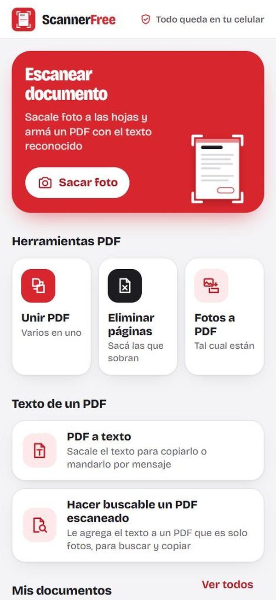
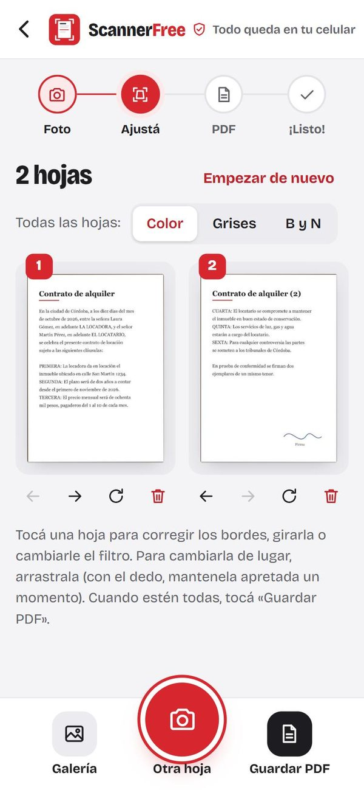
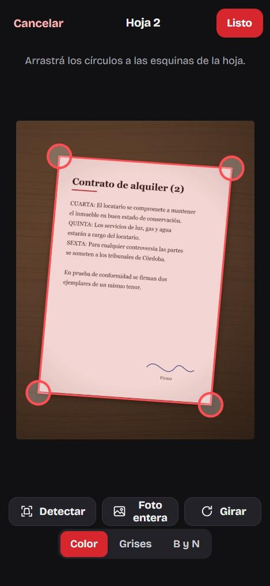
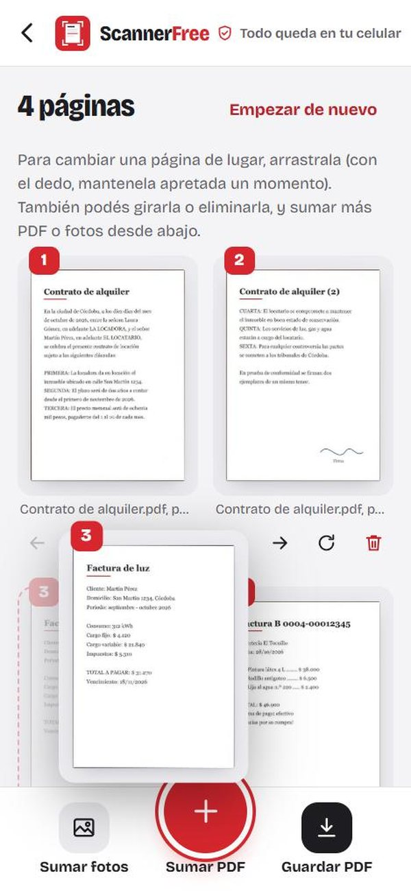
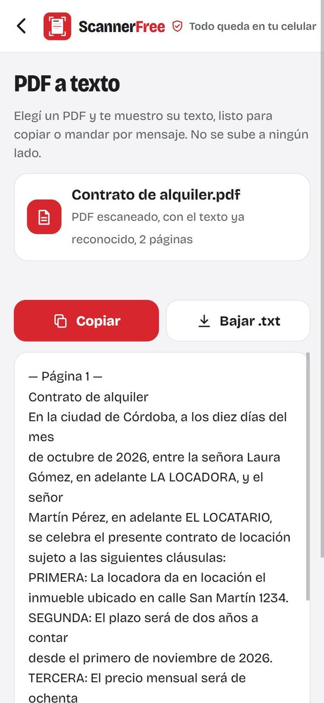
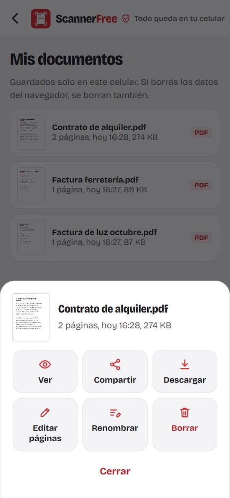
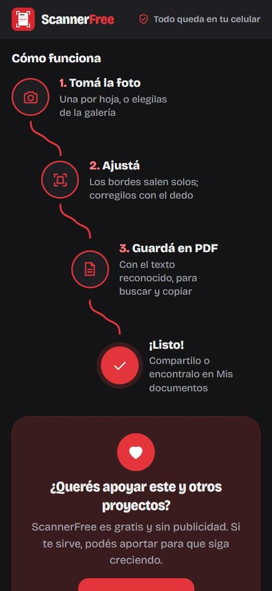

<p align="center">
  
</p>

<h1 align="center">ScannerFree</h1>

<p align="center">
  Escáner de documentos y herramientas PDF <b>gratis, sin publicidad y sin cuenta</b>.<br>
  Todo pasa en tu celular: tus fotos y tus PDF no se suben a ningún lado.
</p>

<p align="center">
  <a href="https://mcagariglio-star.github.io/scannerfree/"><b>Abrir ScannerFree</b></a>
</p>

Le sacás foto a cada hoja: la app encuentra los bordes, la endereza, la deja prolija y arma un PDF donde se puede buscar y copiar el texto. También une PDF, elimina páginas, pasa fotos a PDF y saca el texto de un PDF.

**Tus fotos no salen del celular.** Todo se procesa en el teléfono: no hay servidor, no hay registro, no hay seguimiento. La página ni siquiera tiene permiso para conectarse a otros sitios (lo bloquea su `Content-Security-Policy`).

## Cómo se ve

<table>
  <tr>
    <td align="center" width="33%"><br><sub><b>Inicio</b><br>Todo a un toque</sub></td>
    <td align="center" width="33%"><br><sub><b>Escanear</b><br>Los pasos te guían</sub></td>
    <td align="center" width="33%"><br><sub><b>Ajustar bordes</b><br>Salen solos; se corrigen con el dedo</sub></td>
  </tr>
  <tr>
    <td align="center"><br><sub><b>Unir PDF</b><br>Ordená arrastrando las páginas</sub></td>
    <td align="center"><br><sub><b>PDF a texto</b><br>Copiar o bajar como .txt</sub></td>
    <td align="center"><br><sub><b>Mis documentos</b><br>Guardados en tu celular</sub></td>
  </tr>
  <tr>
    <td align="center"><br><sub><b>Modo oscuro</b><br>Se adapta solo al celular</sub></td>
    <td colspan="2" valign="middle">
      <sub>Los documentos de las capturas son de ejemplo, inventados para mostrar la app.</sub>
    </td>
  </tr>
</table>

## Qué hace

- Foto con la cámara o desde la galería, varias hojas por documento
- Detecta las esquinas de la hoja sola; si hace falta, las corregís con el dedo (con lupa)
- Filtros: color (blanquea el papel), grises y blanco y negro
- Girar, reordenar (arrastrándolas con el dedo o el mouse) y sacar hojas
- PDF con el texto reconocido (OCR en español) invisible encima de la imagen
- Compartir directo (WhatsApp, mail, Drive…) o descargar
- **Herramientas PDF**: unir varios PDF, eliminar páginas, girarlas y reordenarlas, y crear un PDF desde fotos. Las páginas se copian tal cual: el texto y la calidad no cambian
- **Texto de un PDF**: «PDF a texto» saca el texto para copiarlo o compartirlo, y «Hacer buscable» le agrega el texto invisible a un PDF escaneado. pdf-inspector lee el texto que ya trae el PDF y las páginas que son fotos se reconocen con Tesseract
- **Mis documentos**: los PDF que hacés quedan guardados en el celular para verlos, compartirlos, renombrarlos, editarlos o borrarlos
- Inicio con todo a mano y pasos guiados: tomá la foto, ajustá, guardá en PDF, ¡listo!
- Se instala como app y anda sin internet
- Si el navegador se cierra mientras sacás la foto, las hojas quedan guardadas en el celular

## Cómo usarla

1. En el celular, abrí **https://mcagariglio-star.github.io/scannerfree/** (en Chrome, Edge o Safari).
2. Para tenerla como una app más: en Chrome tocá los tres puntitos → **Agregar a la pantalla principal** (o «Instalar app»); en el iPhone, en Safari: **Compartir** → **Agregar a inicio**.
3. La primera vez se prepara para andar sin internet (unos 25 MB, conviene tener Wi-Fi). Después abre al instante, aunque no tengas señal.

No hace falta crear una cuenta ni dar ningún dato.

## Para quien quiera colaborar

ScannerFree es una página web común (HTML, CSS y JavaScript, sin nada que compilar) que se instala como app. Si querés mejorarla, traducirla o corregir algo, ¡bienvenido!

**Qué hay en cada archivo**

- `index.html` y `app.css`: las pantallas y el diseño.
- `app.js`: todo lo que hace la app. Detecta los bordes y endereza la hoja con OpenCV.js, reconoce el texto con Tesseract.js, arma los PDF con pdf-lib, muestra las páginas con pdf.js y lee el texto de un PDF con pdf-inspector.
- `sw.js`: guarda la app en el celular para que ande sin internet. Si cambiás algún archivo, subí el número de `VERSION` para que los celulares bajen la versión nueva.
- `vendor/`: las librerías, incluidas tal cual para no depender de otros sitios (ver [vendor/LICENCIAS.md](vendor/LICENCIAS.md)).

**Probar tus cambios en la computadora**

Hace falta tener Python. En la carpeta del proyecto, escribí:

```
python herramientas/servidor.py
```

Eso prende un servidor de prueba que solo se ve dentro de tu casa; no publica nada. Después:

- **En la misma computadora**, abrí `http://localhost:8030`. Ahí anda todo.
- **Desde el celular**, conectado al mismo Wi-Fi, abrí la dirección que muestra el servidor (algo como `http://192.168.1.51:8030`). Ahí se puede escanear, armar PDF y descargarlos, pero no instalarla, usarla sin internet ni compartir. Los navegadores solo permiten eso en direcciones seguras (las que empiezan con `https`), y la dirección del Wi-Fi de casa no lo es. En la versión publicada anda todo.

## Apoyar el proyecto

ScannerFree es gratis y sin publicidad. Si te sirve y querés ayudar a que este y otros proyectos sigan creciendo, podés aportar en cripto:

| Red | Dirección |
|---|---|
| **BNB Smart Chain (BEP20)** | `0xE7C0f00a914EcBc1C73E2175BA66af0e4003Fba3` |

Mandá **solo por la red BNB Smart Chain (BEP20)**: BNB o tokens BEP20 como USDT o USDC. Si lo enviás por otra red, el aporte se puede perder.

## Licencia

[GPL-3.0](LICENSE). Podés usarla, copiarla, cambiarla y compartirla; si distribuís una versión cambiada, tiene que seguir siendo libre y con el código abierto.
